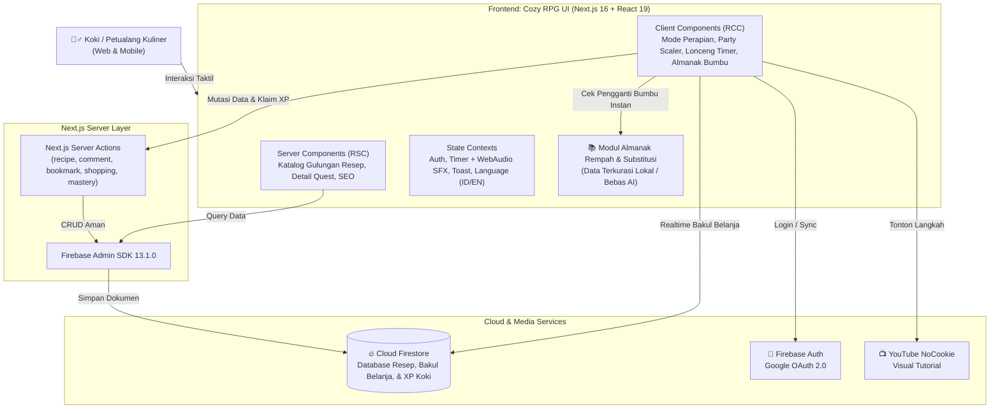

# 📜 Blueprint Transformasi Resepedia: Edisi "Cozy Nusantara RPG" & Zero AI Slop

> **Dokumen Spesifikasi Perombakan UI/UX, Pembersihan Arsitektur AI, & Peta Jalan Pengembangan Baru**  
> **Basis Proyek:** Resepedia (Next.js 16 + React 19 + Tailwind CSS v4 + Firebase)  
> **Arah Desain Baru:** *Cozy Culinary RPG* (Terinspirasi dari *Stardew Valley*, *Chef RPG*, *Coffee Talk*, & Warisan Lontar Nusantara)

---

## 📑 Daftar Isi
1. [Visi Transformasi: Mengapa Cozy RPG & Zero AI Slop?](#1-visi-transformasi-mengapa-cozy-rpg--zero-ai-slop)
2. [Protokol Eliminasi "AI Slop" (Pembersihan Kode & Visual)](#2-protokol-eliminasi-ai-slop-pembersihan-kode--visual)
3. [Sistem Desain "Cozy Nusantara RPG" (Tailwind CSS v4)](#3-sistem-desain-cozy-nusantara-rpg-tailwind-css-v4)
4. [Pemetaan Transformasi Komponen UI/UX](#4-pemetaan-transformasi-komponen-uiux)
5. [Arsitektur Sistem Baru (Tanpa LLM Eksternal)](#5-arsitektur-sistem-baru-tanpa-llm-eksternal)
6. [Rekomendasi Pengembangan Fitur Baru (High-Craft & Deterministik)](#6-rekomendasi-pengembangan-fitur-baru-high-craft--deterministik)
7. [Pembaruan Skema Data Firestore & LocalStorage](#7-pembaruan-skema-data-firestore--localstorage)
8. [Daftar Periksa Eksekusi (Action Plan)](#8-daftar-periksa-eksekusi-action-plan)

---

## 1. Visi Transformasi: Mengapa Cozy RPG & Zero AI Slop?

Aplikasi web modern saat ini mengalami kejenuhan akibat pola desain generik (**"AI Slop"**): tombol mengambang berikon kilauan (*sparkles*), gradasi ungu-biru neon, kartu kaca (*glassmorphism*) dingin tanpa karakter, serta asisten *chatbot* LLM yang sering berhalusinasi saat ditanya takaran bumbu tradisional.

Untuk aplikasi pelestarian kuliner seperti **Resepedia**, pendekatan tersebut terasa asing dari hangatnya dapur tradisional Indonesia. Oleh karena itu, transformasi ini mengusung dua pilar utama:

1. **Zero AI Slop (100% Kerajinan Manusia & Deterministik)**:
   - Menghapus total ketergantungan pada Google Gemini API dan laci *chat* AI.
   - Mengganti fitur konsultasi bumbu dengan **"Almanak Rempah & Kitab Substitusi Nusantara"** yang terkurasi, instan, akurat 100%, bebas biaya token API, dan berfungsi penuh secara *offline*.
2. **Cozy Nusantara RPG UI/UX**:
   - Mengubah pengalaman memasak menjadi petualangan kuliner yang hangat, taktil, dan menyenangkan.
   - Menggunakan palet warna organik (kertas lontar, kayu jati, terakota cobek, hijau daun pandan, kuning kunyit), bingkai bergaya buku resep klasik (*Grimoire*), indikator kesulitan berbasis *Quest Rank*, dan daftar bahan bergaya *Inventory Slot*.

---

## 2. Protokol Eliminasi "AI Slop" (Pembersihan Kode & Visual)

Berikut adalah daftar inventaris kode, dependensi, dan elemen antarmuka yang **wajib dihapus atau diganti** dari repositori Resepedia:

### 2.1 Penghapusan Berkas (File Deletion)
| Path Berkas | Alasan Penghapusan |
|---|---|
| `src/app/api/chat/route.ts` | Menghapus *serverless endpoint* streaming Google Gemini 2.5 Flash. |
| `src/components/ai/AIChatDrawer.tsx` | Menghapus komponen laci *chatbot* AI dari antarmuka pengguna. |
| `src/contexts/AIContext.tsx` | Menghapus *state provider* laci AI global. |

### 2.2 Pembersihan Dependensi (`package.json`)
Jalankan perintah berikut untuk memangkas ukuran *bundle* produksi dan menghapus paket terkait AI:
```bash
npm uninstall @google/genai react-markdown remark-gfm
```
*(Catatan: Jika `react-markdown` tidak digunakan di luar `AIChatDrawer.tsx`, penghapusannya akan menghemat ukuran bundle client secara signifikan).*

### 2.3 Pembersihan Variabel Lingkungan (`.env.local` & Vercel)
- Hapus variabel `GEMINI_API_KEY` dari `.env.local`, `.env.example`, dan pengaturan *Environment Variables* di dashboard Vercel.

### 2.4 Audit & Eliminasi Visual "AI Slop" di Seluruh Komponen
| Pola "AI Slop" Lama | Pengganti "Cozy RPG" Baru |
|---|---|
| Ikon `Sparkles`, `Bot`, `Wand2`, `Cpu` dari `lucide-react` | Ikon organik/klasik: `Scroll`, `Flame`, `Compass`, `BookOpen`, `Utensils`, `MortarPestle` (SVG kustom), `Shield`, `Award` |
| Gradasi neon/generik (`bg-linear-to-r from-indigo-500 to-purple-500`) | Tekstur warna solid hangat dengan aksen batas ganda (`border-2 border-amber-900/80`) dan bayangan tegas (`shadow-[4px_4px_0px_#3A2415]`) |
| Bayangan kabur modern (`shadow-xl backdrop-blur-md bg-white/70`) | Kartu kertas lontar solid (`bg-[#F6EFE2]`) dengan sudut berornamen atau potongan tegas |
| Tombol "Tanya AI Chef" pada `RecipeDetailClient.tsx` & `Navbar.tsx` | Tombol **"Buka Almanak Bumbu"** (kamus substitusi bahan instan berbasis data lokal) |
| Latar `zinc-950` dingin pada *Zen Cook Mode* | Latar **"Perapian Dapur" (`#1C1410` - Kayu Arang Hangat)** dengan cahaya lentera amber (`#E69F38`) |

---

## 3. Sistem Desain "Cozy Nusantara RPG" (Tailwind CSS v4)

Seluruh konfigurasi tema pada `src/app/globals.css` dirombak menggunakan sintaks `@theme` Tailwind CSS v4 untuk menghadirkan suasana **Kedai & Dapur Nusantara Klasik**.

### 3.1 Palet Warna (Lontar, Kayu Jati, & Rempah)

```css
/* src/app/globals.css */
@import "tailwindcss";

@theme {
  /* Tipografi */
  --font-display: "Fraunces", "Playfair Display", Georgia, serif;
  --font-sans: "Plus Jakarta Sans", -apple-system, BlinkMacSystemFont, sans-serif;
  --font-mono: "JetBrains Mono", monospace;

  /* Palet Dasar Siang (Lontar & Dapur Terang) */
  --color-parchment-50: #FCF9F2;
  --color-parchment-100: #F6EFE2;   /* Latar Utama Halaman */
  --color-parchment-200: #EFE4CE;   /* Latar Kartu / Slot Inventory */
  --color-parchment-300: #E2D1B0;   /* Latar Hover / Aktif */

  /* Palet Kayu & Tinta (Bingkai & Teks) */
  --color-wood-950: #1C1410;        /* Latar Utama Dark Mode (Arang Perapian) */
  --color-wood-900: #2C1E16;        /* Warna Teks Utama & Bayangan Tegas */
  --color-wood-800: #422B1D;        /* Latar Kartu Dark Mode */
  --color-wood-700: #5C3A21;        /* Warna Bingkai Utama (Kayu Jati) */
  --color-wood-500: #8C6239;        /* Bingkai Sekunder / Ornamen */

  /* Aksen Rempah Nusantara (Indikator & Tombol) */
  --color-terracotta-600: #C85A32;  /* Primary CTA (Merah Bata / Cobek) */
  --color-terracotta-700: #A64422;
  --color-pandan-600: #4A7C59;      /* Success / Bahan Tersedia / Mudah */
  --color-kunyit-500: #D99B26;      /* Gold / Rating / Highlight / Menengah */
  --color-cabai-600: #B83B2B;       /* Danger / Pedas / Sulit (Rank S) */
}

/* Utilitas Taktil RPG */
@layer utilities {
  .rpg-card {
    background-color: var(--color-parchment-200);
    border: 2px solid var(--color-wood-700);
    box-shadow: 4px 4px 0px var(--color-wood-900);
    border-radius: 0.5rem;
    transition: transform 120ms ease, box-shadow 120ms ease;
  }

  .rpg-card-interactive:hover {
    transform: translate(-1px, -1px);
    box-shadow: 5px 5px 0px var(--color-wood-900);
  }

  .rpg-card-interactive:active {
    transform: translate(3px, 3px);
    box-shadow: 1px 1px 0px var(--color-wood-900);
  }

  .rpg-button-primary {
    background-color: var(--color-terracotta-600);
    color: var(--color-parchment-50);
    border: 2px solid var(--color-wood-900);
    box-shadow: 0px 4px 0px var(--color-wood-900);
    font-weight: 700;
    transition: all 100ms ease;
  }

  .rpg-button-primary:active {
    transform: translateY(3px);
    box-shadow: 0px 1px 0px var(--color-wood-900);
  }

  .rpg-slot {
    background-color: var(--color-parchment-100);
    border: 2px inset var(--color-wood-500);
    border-radius: 0.375rem;
  }
}
```

### 3.2 Karakteristik Visual Utama
1. **Tactile Button Physics**: Setiap tombol terasa seperti tombol fisik kayu/kulit. Saat ditekan (`:active`), tombol turun $3\text{px}$ dan bayangan bawahnya menyusut dari $4\text{px}$ menjadi $1\text{px}$.
2. **Zero Soft Blur Shadows**: Seluruh bayangan `shadow-lg` atau `shadow-xl` diganti menjadi *hard-edge offset shadows* (`shadow-[4px_4px_0px_#2C1E16]`) khas buku komik/gim piksel & ilustrasi tangan.
3. **Ornamen Bingkai**: Sudut kartu utama pada halaman detail resep menggunakan pembatas bergaris ganda (*double border*) menyerupai naskah kuno atau papan pengumuman *Guild*.

---

## 4. Pemetaan Transformasi Komponen UI/UX

Berikut adalah panduan perombakan langsung untuk setiap komponen di dalam `src/components/`:

### 4.1 Navigasi (`Navbar.tsx` & `MobileBottomNav.tsx`) -> **"Papan Guild & Sabuk Petualang"**
- **Desktop Navbar (`Navbar.tsx`)**:
  - Tampil menyerupai balok kayu jati di bagian atas halaman dengan lencana logo **Resepedia** bergaya papan nama kedai.
  - Bilah pencarian diubah menjadi **"Cari Gulungan Resep atau Bahan..."** dengan tampilan bak perkamen gulung.
  - Menampilkan **Lencana Gelar Koki** di sebelah avatar pengguna (contoh: *Lv. 3 Peracik Bumbu*).
- **Mobile Bottom Nav (`MobileBottomNav.tsx`)**:
  - Dirancang menyerupai **RPG Hotbar / Item Belt** 5-slot di bagian bawah layar ponsel:
    1. 🏠 **Kedai** (Beranda)
    2. 🗺️ **Peta** (Eksplorasi Kepulauan)
    3. 🪶 **Tulis** (Tombol tengah menonjol bergaya pena bulu & perkamen untuk menulis resep baru)
    4. 🧺 **Bakul** (Daftar Belanja Pasar)
    5. 📖 **Grimoire** (Koleksi & Buku Resepku)

### 4.2 Kartu Resep (`RecipeCard.tsx`) -> **"Gulungan Resep (Recipe Scroll Card)"**
- **Header Gambar**: Dibingkai dengan border dalam tipis (`border-b-2 border-wood-700`).
- **Sistem Rank Kesulitan (Menggantikan Badge Biasa)**:
  - `Easy` $\rightarrow$ **★ Rank C (Pemula)** — Warna Hijau Pandan
  - `Medium` $\rightarrow$ **★★ Rank B (Terampil)** — Warna Kuning Kunyit
  - `Hard` $\rightarrow$ **★★★ Rank A (Mahakarya)** — Warna Merah Cabai
- **Atribut Statistik Hidangan (RPG Buff Stats)**:
  - ⏳ `prepTime + cookTime` ditampilkan sebagai **Waktu Meracik**.
  - ⚡ `calories` ditampilkan sebagai **Pemulihan Stamina** (contoh: `+350 Energi`).
  - 🔥 `spicy` ditampilkan sebagai **Elemen Pedas** dengan ikon api merah.
  - 🛡️ **Asal Wilayah** ditampilkan sebagai segel kerajaan/kepulauan (contoh: *Segel Sumatra*).

### 4.3 Detail Resep (`RecipeDetailClient.tsx`) -> **"Meja Racik & Lembar Quest"**
- **Daftar Bahan (`ingredients`) $\rightarrow$ "Kotak Inventori Bahan (Crafting Grid)"**:
  - Bahan tidak lagi ditampilkan sebagai daftar teks polos, melainkan sebagai **Slot Inventori (`rpg-slot`)** berbentuk grid 2 kolom di mobile dan 3–4 kolom di desktop.
  - Setiap slot menampilkan:
    - Ikon kategori bahan (Rempah, Daging, Sayur, Cairan).
    - Nama bahan & takaran terhitung di pojok kanan bawah slot (seperti jumlah *item* di gim RPG, misal `x500 gr`).
    - Tag peran (`role`: *Bumbu Halus*, *Bahan Utama*, *Pelengkap*).
    - Klik pada slot bahan akan menandai bahan sebagai **"Sudah Siap di Meja"** (efek centang hijau pandan) atau membuka *tooltip* substitusi jika bahan tidak tersedia.
- **Tahapan Memasak (`instructions`) $\rightarrow$ "Tahapan Quest Memasak"**:
  - Setiap langkah memiliki nomor urut di dalam segel belah ketupat (`rotate-45`).
  - Dilengkapi kotak centang per langkah yang mengisi *Progress Bar* di bagian atas halaman.

### 4.4 Pengubah Porsi (`PortionScaler.tsx`) -> **"Ukuran Rombongan (Party Size Scaler)"**
- Selain tombol `-` dan `+` menggunakan `fraction-scaler.ts`, tambahkan *preset* cepat bertema RPG:
  - 🧍 **Pengelana Tunggal** ($1\text{ Porsi}$)
  - 👥 **Jamuan Berdua** ($2\text{ Porsi}$)
  - ⛺ **Rombongan Kecil** ($4\text{ Porsi}$)
  - 🏰 **Pesta Rakyat / Kenduri** ($8\text{ Porsi}$)

### 4.5 Zen Cook Mode (`HandsFreeCookModal.tsx`) -> **"Mode Perapian (Hearth Crafting Mode)"**
- Mengubah tampilan *fullscreen* menjadi suasana dapur malam yang tenang:
  - Latar belakang `bg-[#1C1410]` dengan bingkai ornamen emas-kuningan (`border-[#8C6239]`).
  - Bar progres di atas bertuliskan **"Progres Meracik Hidangan"** yang menyala keemasan.
  - Fitur *Web Speech API* (`window.speechSynthesis`) dipertahankan dan diberi label **"Suara Petuah Empu Dapur"** (membacakan langkah secara lantang tanpa perlu menyentuh layar).
  - Saat pengguna menyelesaikan langkah terakhir dan menekan **"Hidangan Selesai!"**, tampilkan layar perayaan **"HIDANGAN BERHASIL DIRACIK! (+50 XP Dapur)"** lengkap dengan efek suara kemenangan dari *Web Audio Synthesizer*.

### 4.6 Timer Memasak (`CookingTimer.tsx`) -> **"Jam Pasir & Lonceng Gamelan"**
- Visual mengambang berbentuk lencana kayu bundar/persegi panjang dengan ikon jam pasir berputar.
- **Upgrade Nada Dering Web Audio API (`TimerContext.tsx`)**:
  - Ubah frekuensi *oscillator* standar menjadi tangga nada **Pentatonik Pelog/Slendro (Gamelan)** atau *RPG Victory Chime* (frekuensi berurutan $523.25\text{ Hz}$ [C5] $\rightarrow$ $659.25\text{ Hz}$ [E5] $\rightarrow$ $783.99\text{ Hz}$ [G5] $\rightarrow$ $1046.50\text{ Hz}$ [C6] dengan amplop *decay* hangat menyerupai bilah saron/marimba).

---

## 5. Arsitektur Sistem Baru (Tanpa LLM Eksternal)

Dengan dihapusnya `/api/chat` dan Google Gemini API, arsitektur sistem menjadi lebih ramping, cepat, bebas latensi pihak ketiga, dan 100% deterministik.



---

## 6. Rekomendasi Pengembangan Fitur Baru (High-Craft & Deterministik)

Sebagai pengganti fitur AI yang dihapus sekaligus memperkuat identitas **Cozy RPG**, berikut adalah **5 rekomendasi fitur unggulan** yang sangat relevan dengan arsitektur Resepedia saat ini:

### Rekomendasi 1: "Almanak Rempah & Kitab Substitusi" (Pengganti AI Chat)
Alih-alih menggunakan *chatbot* AI yang lambat dan boros kuota untuk menjawab *"Apa pengganti kemiri?"*, bangun modul deterministik `src/lib/data/spice-almanac.ts` dan komponen `SpiceAlmanacModal.tsx`.
- **Cara Kerja**:
  - Berisi kamus terstruktur 40+ bumbu & bahan khas Indonesia (Kemiri, Kluwek, Lengkuas, Kencur, Daun Jeruk, Asam Kandis, Terasi, Santan, dll.).
  - Setiap entri memuat: **Nama Daerah**, **Profil Rasa**, **Fungsi Masakan**, **Takaran Pengganti Darurat** (misal: *1 butir Kemiri = 1/2 sdt Kacang Mede/Almond sangrai*), dan **Tips Penyimpanan**.
  - Pada halaman detail resep, sistem secara otomatis mendeteksi kata kunci bahan dan menyematkan ikon kaca pembesar kecil `🔍` di samping bahan tersebut. Ketika diklik, muncul *RPG Item Tooltip* berisi informasi substitusi secara instan ($0\text{ ms}$ latensi!).

### Rekomendasi 2: Peta Interaktif Kepulauan Nusantara (`NusantaraMap.tsx`)
Saat ini Resepedia sudah mengelompokkan resep ke dalam 6 wilayah (`Sumatra`, `Jawa`, `Bali`, `Sulawesi`, `Kalimantan`, `Papua`).
- **Pengembangan**:
  - Buat komponen peta ilustrasi SVG interaktif bergaya peta harta karun / RPG di halaman **Beranda** dan **Eksplorasi**.
  - Setiap kepulauan dapat diklik untuk memfilter resep secara langsung, lengkap dengan indikator progres penguasaan wilayah (contoh: *"Kepulauan Sulawesi: 2/4 Resep Telah Dimasak"*).

### Rekomendasi 3: Sistem "Buku Log Koki & Lencana Kemahiran" (Cooking Mastery & XP)
Berikan kepuasan progres (*sense of progression*) khas gim RPG baik bagi pengguna *login* maupun tamu (*localStorage*):
- **Mekanisme**:
  - Setiap kali pengguna menyelesaikan langkah terakhir di **Mode Perapian (Zen Cook Mode)** atau mengunggah ulasan di resep, resep tersebut ditandai sebagai **"Telah Dikuasai (Mastered)"**.
  - Rumus perolehan poin pengalaman memasak ($XP$) berdasarkan tingkat kesulitan resep:
    $$\text{XP}_{\text{perolehan}} = \begin{cases} 50 \text{ XP} & \text{jika } \text{difficulty} = \text{'Easy'} \\ 100 \text{ XP} & \text{jika } \text{difficulty} = \text{'Medium'} \\ 200 \text{ XP} & \text{jika } \text{difficulty} = \text{'Hard'} \end{cases}$$
  - Level Koki dihitung secara deterministik dari total $XP$:
    $$\text{Level} = \lfloor \sqrt{\frac{\text{Total XP}}{25}} \rfloor + 1$$
  - Membuka gelar unik di halaman Profil (`ProfilClient.tsx`):
    - Level 1–2: *Peracik Magang*
    - Level 3–5: *Penjaga Bara Dapur*
    - Level 6–9: *Pendekar Rempah Nusantara*
    - Level 10+: *Empu Kuliner Agung*

### Rekomendasi 4: Efek Suara Taktil Tanpa Berkas Audio Eksternal (`sound-effects.ts`)
Resepedia sudah memiliki implementasi `AudioContext` dan `OscillatorNode` pada `CookingTimer.tsx`. Kita dapat memperluasnya menjadi modul *procedural sound synthesizer* ringan (`< 2 KB`, tanpa perlu mengunduh file `.mp3`):
- **Jenis Suara**:
  - `playClickSound()`: Suara ketukan kayu lembut saat menekan tombol atau mencentang bahan belanjaan.
  - `playPageTurnSound()`: *White noise* terfilter singkat saat membuka gulungan resep atau berpindah langkah di Mode Perapian.
  - `playLevelUpFanfare()`: Akord arpeggio hangat saat menyelesaikan masakan.
- Dilengkapi tombol **Mute / Unmute SFX (`🔊 / 🔇`)** di bilah navigasi atas dan tersimpan di `UserPreferences`.

### Rekomendasi 5: Mode "Lapak Pasar Tradisional" di Daftar Belanja (`BelanjaClient.tsx`)
Saat ini daftar belanja mengelompokkan bahan berdasarkan nama resep (`recipeTitle`). Saat berbelanja di pasar nyata, pengguna sering bolak-balik karena bahan yang sama (misal: *Bawang Merah*) tersebar di 3 resep berbeda.
- **Pengembangan**:
  - Tambahkan *toggle tab* pada halaman **Bakul Belanja**:
    1. 📜 **Per Gulungan Resep** (Tampilan saat ini)
    2. 🏪 **Per Lapak Pasar** (Menggabungkan bahan sejenis secara otomatis ke dalam kategori: *Lapak Rimpang & Bumbu*, *Lapak Sayur & Daun*, *Lapak Daging & Hasil Laut*, dan *Warung Sembako*).

---

## 7. Pembaruan Skema Data Firestore & LocalStorage

Tidak ada perubahan yang merusak (*breaking changes*) pada data resep yang sudah ada. Kita hanya perlu memperluas entitas `User` (`src/types/recipe.types.ts`) secara opsional (dengan *fallback* nilai default agar pengguna lama tetap aman):

```typescript
// src/types/recipe.types.ts

export interface UserPreferences {
  darkMode: boolean;
  language: 'id' | 'en';
  dietary: string[];
  soundEffectsEnabled?: boolean; // Baru: Toggle efek suara RPG
}

export interface UserProfile {
  id: string;
  displayName: string;
  email: string;
  avatarUrl: string | null;
  savedRecipeIds: string[];
  cookedRecipeIds?: string[];    // Baru: Daftar ID resep yang sudah pernah dimasak
  xp?: number;                   // Baru: Total poin pengalaman memasak
  unlockedBadges?: string[];     // Baru: ID lencana kepulauan yang terbuka
  preferences: UserPreferences;
  createdAt: number;
}

// Struktur Data Baru untuk Almanak Rempah (src/lib/data/spice-almanac.ts)
export interface SpiceAlmanacEntry {
  id: string;
  name: string;
  aliases: string[];             // Contoh: ['kemiri', 'candlenut', 'muncang']
  category: 'Rempah Rimpang' | 'Bumbu Kering' | 'Daun Aromatik' | 'Pelengkap';
  flavorProfile: string;
  culinaryRole: string;
  substitutes: Array<{
    name: string;
    ratio: string;               // Contoh: '1:1' atau '1/2 sdt untuk tiap 1 butir'
    notes: string;
  }>;
  storageTip: string;
}
```

---

## 8. Daftar Periksa Eksekusi (Action Plan)

Ikuti urutan langkah pengerjaan berikut agar proses migrasi berjalan mulus tanpa merusak *build* TypeScript (`tsc --noEmit`):

- [ ] **Tahap 1: Pembersihan AI Slop (Clean-up)**
  - [ ] Hapus `src/app/api/chat/route.ts`, `src/components/ai/AIChatDrawer.tsx`, dan `src/contexts/AIContext.tsx`.
  - [ ] Hapus `<AIProvider>` dan `<AIChatDrawer />` dari `src/app/layout.tsx`.
  - [ ] Hapus seluruh pemanggilan `useAI()` pada `Navbar.tsx`, `HomeClient.tsx`, dan `RecipeDetailClient.tsx`.
  - [ ] Jalankan `npm uninstall @google/genai` dan pastikan `npm run build` berjalan bersih.

- [ ] **Tahap 2: Fondasi Desain Cozy RPG (`globals.css` & Font)**
  - [ ] Impor Google Fonts `Fraunces` (untuk judul bergaya buku klasik) dan `Plus Jakarta Sans` pada `src/app/layout.tsx`.
  - [ ] Perbarui token warna dan kelas utilitas `.rpg-card`, `.rpg-button-primary`, serta `.rpg-slot` pada `src/app/globals.css`.

- [ ] **Tahap 3: Implementasi Almanak Rempah (Pengganti AI)**
  - [ ] Buat berkas `src/lib/data/spice-almanac.ts` berisi data kurasi rempah & substitusi Nusantara.
  - [ ] Buat komponen `src/components/recipe/SpiceAlmanacDrawer.tsx` yang dapat dibuka dari Navbar maupun langsung saat pengguna menekan bahan di halaman detail resep.

- [ ] **Tahap 4: Perombakan Komponen Utama**
  - [ ] Ubah `Navbar.tsx` & `MobileBottomNav.tsx` ke tema *Papan Guild & Sabuk Petualang*.
  - [ ] Ubah `RecipeCard.tsx` menjadi *Gulungan Resep* dengan indikator *Rank C/B/A*.
  - [ ] Ubah daftar bahan di `RecipeDetailClient.tsx` menjadi *Grid Slot Inventori* dan `HandsFreeCookModal.tsx` menjadi *Mode Perapian*.

- [ ] **Tahap 5: Gamifikasi & Audio Taktil**
  - [ ] Tambahkan utilitas `src/lib/utils/sound-effects.ts` menggunakan Web Audio API.
  - [ ] Tambahkan pencatatan XP & riwayat masakan selesai pada `ProfilClient.tsx` dan `HandsFreeCookModal.tsx`.